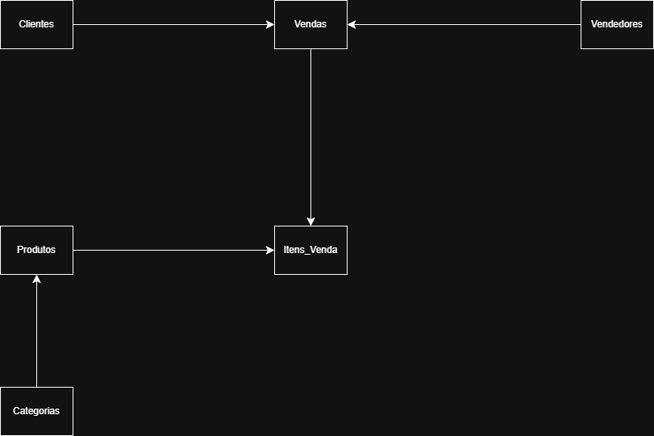

# Projeto 01 - Sistema de Vendas de um Pet Shop

Projeto de banco de dados feito em MySQL para organizar clientes, produtos, vendedores e vendas de um Pet Shop fictício.

## Objetivo

Criar um banco de dados que responda perguntas do dia a dia da loja:
- Quais produtos mais vendem?
- Quanto a loja faturou?
- Qual o faturamento por mês?
- Quais produtos estão com estoque baixo?
- Qual vendedor vendeu mais?

## Tecnologias

- MySQL
- MySQL Workbench
- draw.io (diagrama)
- Git e GitHub

## Diagrama

## Tabelas

- clientes
- categorias
- produtos
- vendedores
- vendas
- itens_venda

## Conceitos usados

- Chave primária e chave estrangeira
- INSERT, SELECT, WHERE, ORDER BY
- JOIN, GROUP BY e SUM

## Como executar

1. Abra o MySQL Workbench
2. Abra o arquivo petshop.sql
3. Execute o script inteiro
4. O banco petshop será criado com as tabelas, os dados e as consultas

## Autor

Jhoni - estudante de Análise e Desenvolvimento de Sistemas